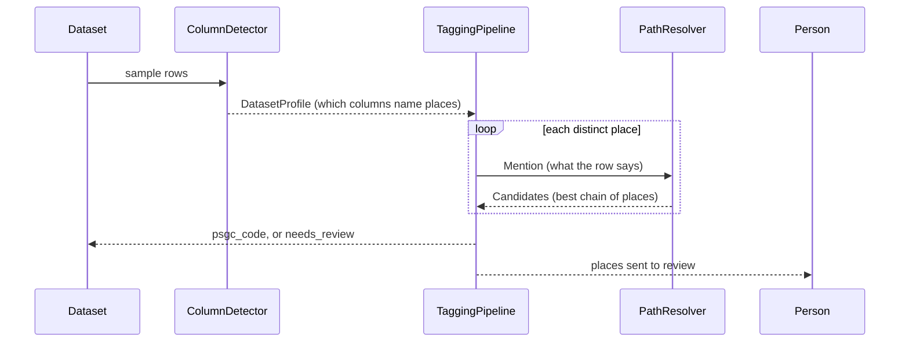

!!! Disclaimer

    This is an independent project that extends the catalog of the [BetterGov.ph Open Data Portal][open-data-portal]. It is not affiliated with, endorsed by, or an official product of BetterGov.ph or any government agency.

## Why this exists

Philippine government datasets are published separately, and each one describes places, offices, and populations in its own way. A file of barangay-level health data and a file of school locations may both refer to the same place, but there is nothing that lets someone join them reliably.

This project aims to make those datasets interconnected. The approach is to use the Philippine Standard Geographic Code (PSGC) as the common key. Every dataset that refers to a place gets tagged with its PSGC code, so records from different sources can be matched, compared, and visualized together.

!!! Terms

    Philippine Standard Geographic Code is the official system maintained by the Philippine Statistics Authority.

## Who it's for

Researchers, developers, and data curators who work with Philippine public data and want to combine it without spending time on name cleanup.

## Status

Early stage. Ideas and structure are still being worked out.

## How it works

The diagram is a conceptual view of the flow. See [Architecture](architecture.md) for how the pieces are implemented.

[open-data-portal]: https://data.bettergov.ph

*[PSGC]: Philippine Standard Geographic Code 