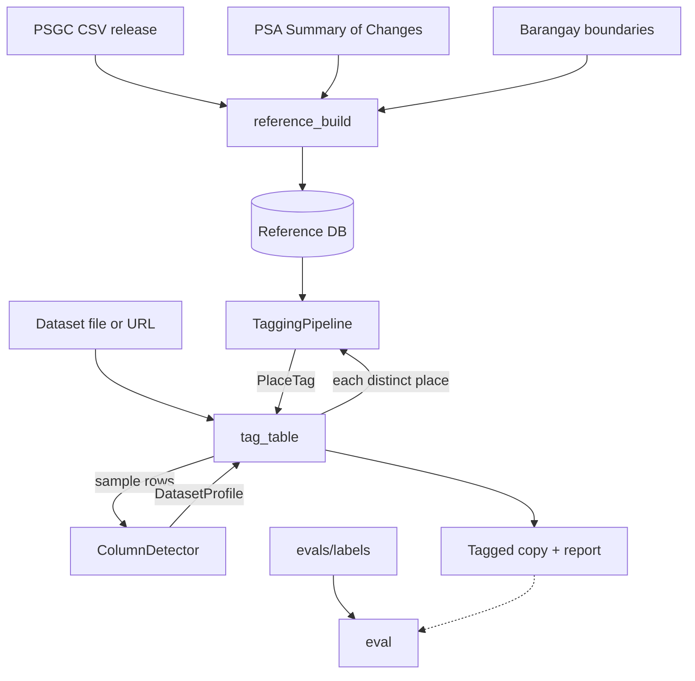

# Architecture

Datasets arrive in different shapes, but a row only needs one thing to join the
rest of the portal: a PSGC code. The pipeline tags each row with one, and marks
the rows it is unsure of for a person to review.

## Tagging a table

`tag_table` loads the dataset into DuckDB, detects its columns from a sample,
and groups the rows by their place columns. Each distinct place is tagged once
and the result is joined back in row order: 86,234 election records name only
1,760 places.

## Column detection

`ColumnDetector` maps each column to a role, using the header first, then the
values (such as a column where most entries start with "City of"):

| Role | Example headers |
| --- | --- |
| `place`, with a PSGC level | `Province`, `City/Municipality`, `Barangay` |
| `free_text` | `Location`, `Address` |
| `latitude`, `longitude` | `lat`, `lng`, when there is exactly one of each |

A PSGC code column is not a name column: codes anywhere in a row become a
`code` hint. GeoJSON and GeoParquet geometry columns are found by `tag_table`
from their type. Detection can be overridden per column in the manifest or with
`--column`.

The result is a `DatasetProfile`. Its `reported_level` is the finest level the
dataset reports at, which is the level the pipeline tags.

## Mentions

`extract_mention` turns a row into a `Mention`, a list of hints about where the
row is. This is the only step that depends on how the file is laid out:

| Row shape | Hints |
| --- | --- |
| Separate place columns | One `name` hint per column, with its level. |
| One `Location` or `Address` column | One `name` hint per comma-separated part, with no level. |
| A 10-digit PSGC code | A `code` hint. |
| Coordinates | A `point` hint. |

When every name hint states its level, the tag is at the finest of them. With
free text the level is open, and the resolver picks it.

## Resolution

`PathResolver` proposes candidates for each hint, then scores each candidate by
its chain (the place, its parents, and its former parents): the share of the
row's hints that the chain explains.

| Hint | Proposes |
| --- | --- |
| `code` | The place for a code, following the crosswalk. |
| `name` | Places whose normalized name or alias matches. With no exact match, near-misses among the children of what the other hints found: misspellings like "Laoagg", and a name with its former name appended, like "El Nido Bacuit" (rapidfuzz). |
| `point` | The barangay the point falls in, or its ancestor at the tag's level. |

| Row | Winner | Why |
| --- | --- | --- |
| Saysain, Bagac, Bataan | Saysain, under Bagac | Explains 3 of 3 words. A barangay named Bataan elsewhere explains 1. |
| Bataan | The province | Ties go to the coarsest level. |
| San Isidro | None | Many places tie, so it goes to review. |

`TaggingPipeline` marks a result `auto` when its score is at least 0.9 and no
other candidate is within 0.05. Everything else is `needs_review`.

## Reference data

`reference_build` turns a release of the
[PSGC CSVs](https://github.com/faeldon/philippines-psgc-shapefiles/releases) into
one DuckDB file. It restores the leading zeros the source drops, takes parents
from the `admN_psgc` columns, keeps Manila's districts as `sub_municipality`,
adds names in parentheses as aliases, and fails if a parent is missing. Run
`just build-reference`.

Older datasets use names, codes, and parents that have since changed. When
PSA's cumulative Summary of Changes workbook is in `data/psa/`, `psa_changes`
turns it into:

- Aliases for old names, such as Compostela Valley for Davao de Oro.
- Crosswalk entries from old codes to today's, following every later change.
- Former parents, such as Region VI for Negros Occidental before the Negros
  Island Region, or Davao del Sur for towns now in Davao Occidental.

With `--boundaries`, barangay polygons are loaded as well, from the
`PH_Adm4_BgySubMuns.parquet` GeoParquet that ph-administrative-boundaries
builds. They are stored in UTM zone 51N and simplified by 1 m.

The database is a build output: rebuilding it from the same release gives the
same file, so nothing else should be stored in it. `ReferenceStore.open` loads
it read-only into memory, where resolution's many small lookups are fast.
`ReferenceStore.locate` places a batch of points in one spatial join: inside a
barangay (score 1.0), or the nearest one within 250 m (score 0.85, accepted
only when a place name in the row agrees). Tests build a `ReferenceStore`
directly from a list of entries.

## Evaluation

`just eval` tags the datasets marked `eval = true` and compares them with their
baselines in `evals/baselines/`. Rates alone cannot show whether tags are right,
so `evals/labels/<name>.csv` holds distinct places checked by hand, and eval
reports the precision of the automatic tags on them, listing each wrong one.

- `just eval --sample 50` adds 50 random unlabeled places to each labels file,
  with the current answer as `expected_code`. Correct it where it is wrong,
  then put your initials in `checked`. Only checked rows are scored.
- `just compare-barangay <name>` adds the answer of the
  [barangay](https://github.com/bendlikeabamboo/barangay) package to each row.
  Rows where the two disagree are the most useful to check first.
- Baselines change only with `just eval --save`, after the differences are
  understood.

## Not yet built

Review decisions are not stored yet. When they are, they belong in a versioned
file of their own (text, code, reviewer), applied on top of the reference when
it loads, not written into the reference database, which a rebuild replaces.
